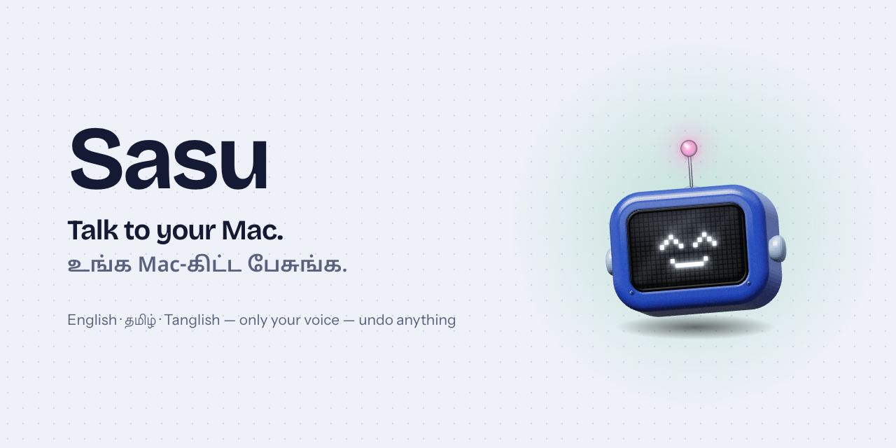
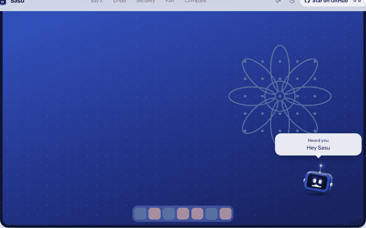
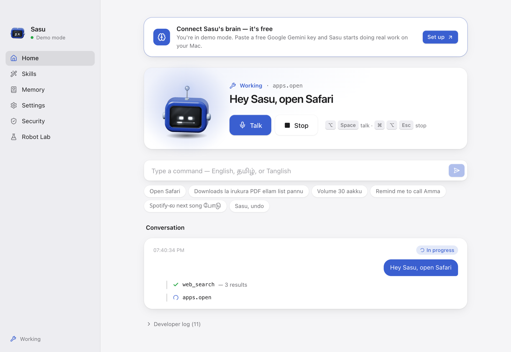
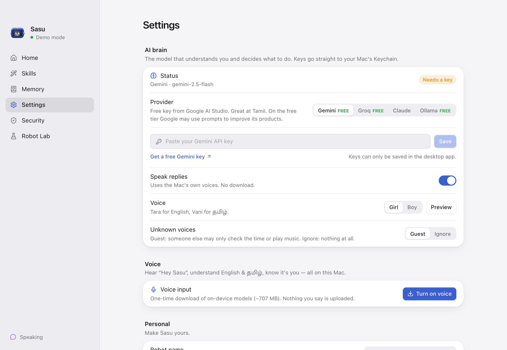
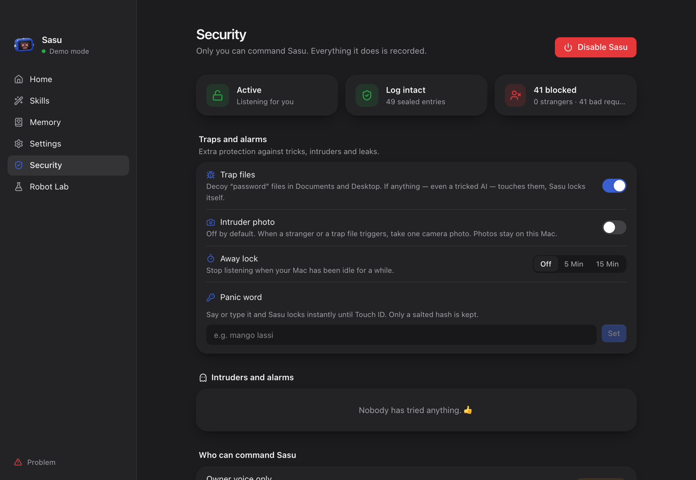
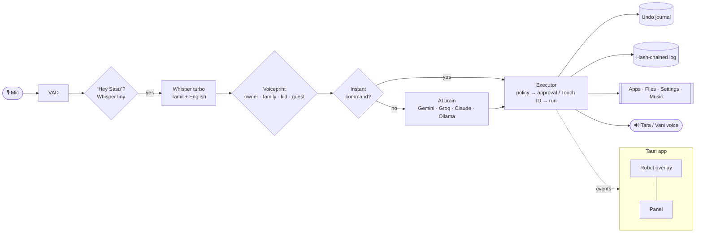

<div align="center">

<picture>
  <source media="(prefers-color-scheme: dark)" srcset="docs/images/banner-dark.png">
  
</picture>

**A little robot that lives on your Mac and does things when you talk to it,
in English, தமிழ், or Tanglish. It only listens to you, and anything it does can be undone.**

[](LICENSE)
[](#install)
[](https://tauri.app)
[](core)
[](https://github.com/RavirajSarangan/agentsasu/actions)
[](https://github.com/RavirajSarangan/agentsasu/stargazers)

[**Download**](https://github.com/RavirajSarangan/agentsasu/releases/latest/download/Sasu-mac.dmg) · [**Website**](https://sasu-web.vercel.app) · [Compare](https://sasu-web.vercel.app/compare.html) · [Privacy](PRIVACY.md) · [Security](SECURITY.md) · [Contributing](CONTRIBUTING.md)



</div>

---

## Just say “Hey Sasu”

No buttons, no commands to learn. Speak the way you'd talk to a friend.

| You say | Language | Sasu does |
| --- | --- | --- |
| “Hey Sasu, open Safari and look up flights to Chennai” | English | Opens Safari and searches |
| “Downloads la irukura PDF ellam oru folder-la podu” | Tanglish | Shows the plan, then moves the PDFs |
| “சாசு, பாட்டு போடு” | தமிழ் | Plays music, answers in Tamil |
| “Good morning” | English | Weather, today's meetings and reminders |
| “Focus 25 minutes” | English | Closes distractions, then restores them |
| “இது என்ன?” | தமிழ் | Looks at your screen and explains it in Tamil |
| “Translate mode” | English | You speak Tamil, Sasu says it in English, and back |
| “Remember amma's birthday is June 3” | English | Saves it, encrypted, for later |
| “Start meeting” … “meeting mudinjathu” | Tanglish | Live captions on your Mac, then notes and action items in Apple Notes |
| “Safari-um Notes-um side by side” | Tanglish | Arranges the windows (undoable) |
| “Munnaadi copy panna link enna?” | Tanglish | Finds what you copied earlier and puts it back |
| “Inniku diary” | Tanglish | Takes a spoken diary entry, encrypted |
| “Sasu, undo” | any | Puts back whatever it just changed |

Common requests (music, volume, opening apps, time, battery, dark mode) run **on your Mac in about 1.5 s**, without any AI service.
Everything else goes to the AI you choose: free **Gemini** or **Groq**, **Claude**, or **Ollama** fully offline.

## Only on Sasu

<table>
<tr>
<td width="50%" valign="top">

**↩️ Undo for everything**<br>
Every change is written down with how to reverse it. Files go back, settings return, apps close.
Say “undo” or press <kbd>⌘</kbd><kbd>⌥</kbd><kbd>Z</kbd>.

**📋 Plan first**<br>
Anything with several steps shows the plan and waits for your “go”.

**🗣️ Speaks your mix**<br>
Answers in the language you used, switching between Tamil (Vani) and English (Tara) voices mid-sentence.

**👨‍👩‍👧 Family voices**<br>
Enrol family and kids. Kids get music, YouTube and jokes; only you can do risky things.

</td>
<td width="50%" valign="top">

**🧭 The robot goes where it works**<br>
It glides over to the app it's using, so you see what it touches.

**🌅 Briefings and focus**<br>
“Good morning” gives you weather, meetings and reminders. “Focus 25” closes distractions and brings them back after.

**🔤 Translator and screen reader**<br>
Live Tamil ⇄ English translation, “what's on my screen?”, “read this to me”, and Tamil voice-typing into any app.

**🎵 Personality**<br>
Dances to Spotify, sleepy at night, festival greetings on Pongal and Deepavali, four sound packs (one in raga Mayamalavagowla).

</td>
</tr>
</table>

<p align="center">
  
  
</p>

## Security

An assistant that can touch your whole Mac has to be hard to misuse: by people nearby, websites, other apps, and AI tricks hidden in files.

| Protection | How it works |
| --- | --- |
| **Only your voice** | An encrypted voiceprint is checked on every command. Strangers get guest mode, or nothing. |
| **Touch ID for risky steps** | Deleting, system changes, anything outside your home folder. Voice alone is never enough. |
| **Trap files** | Decoy “password” files. If anything (even a tricked AI) touches them, Sasu locks and alarms. |
| **Leak guard** | Text read from files or web pages can't be smuggled out through links or commands. |
| **Panic word** | Say it and Sasu locks instantly, until Touch ID. |
| **SOS phrase** | A secret phrase texts your emergency contact after a 5-second countdown you can cancel. |
| **Lost-Mac alarm** | Trap file touched or 3 strangers in 10 minutes: loud siren, red robot, screen locks. Touch ID stops it. |
| **Intruder log and photo** | Every stranger attempt is logged; an optional single camera photo. |
| **Deaf when you're away** | Locks with the screen, fast user switching, and idle time. <kbd>⌘</kbd><kbd>⌥</kbd><kbd>Esc</kbd> stops everything. |
| **Tamper-evident log** | Every action is sealed in a hash chain; edits show up on the Security page. |
| **Locked-down app** | Local server on 127.0.0.1 only, a secret token per launch passed over stdin, strict CSP, per-window permissions. |

<p align="center"></p>

### Privacy

Audio, voiceprints, memories, photos and the activity log **never leave your Mac**.
Only the text of a request (and a screenshot, if you ask about your screen) goes to the AI provider you picked,
and the **privacy meter** shows exactly how much after every request. No accounts, no telemetry.
Read the full [Privacy Policy](PRIVACY.md).

## How it works



| Part | Tech |
| --- | --- |
| Desktop shell | Tauri 2 (Rust): windows, Touch ID, Keychain, hotkeys, haptics |
| UI | React 19, TanStack Router/Query/Store, Tailwind 4, Motion, [robot-heads](https://github.com/fayazara/robot-heads) |
| Core | Python 3.12, FastAPI, sherpa-onnx (VAD, Whisper, voiceprint), macOS `say` |
| Site | Vite + React on Vercel |

## Install

### Download

**[⬇ Download Sasu for Mac](https://github.com/RavirajSarangan/agentsasu/releases/latest/download/Sasu-mac.dmg)** (Apple Silicon, macOS 13+)

1. Open the DMG and drag **Sasu** to **Applications**.
2. Sasu isn't notarized by Apple yet, so the first time macOS says it “can't be opened”.
   Open **System Settings → Privacy & Security**, scroll down and click **Open Anyway** next to Sasu.
   (On older macOS: right-click Sasu → Open.) You only do this once.
3. Allow the microphone when asked.

### From source

```bash
git clone https://github.com/RavirajSarangan/agentsasu && cd agentsasu
nvm use && pnpm install
pnpm dev
```

Needs macOS 13+ on Apple Silicon, Node 24, pnpm 10, Rust and [uv](https://docs.astral.sh/uv/).

**First run**

1. **Settings → AI brain**: paste a free key from [Google AI Studio](https://aistudio.google.com/apikey), or pick Ollama.
2. **Settings → Voice → Turn on voice** (a one-time ~700 MB download that stays on your Mac), then **Enrol my voice**.
3. Say **“Hey Sasu”**.

| Shortcut | Does |
| --- | --- |
| <kbd>⌥</kbd><kbd>Space</kbd> | Talk without the wake word |
| <kbd>⌘</kbd><kbd>⌥</kbd><kbd>Z</kbd> | Undo the last request |
| <kbd>⌘</kbd><kbd>⌥</kbd><kbd>Esc</kbd> | Stop everything |

## Project layout

```
apps/desktop/   Tauri app: React UI + src-tauri (Rust shell)
apps/web/       Landing site, compare, privacy and terms pages
core/           Python agent: voice, brain, tools, security, undo
packages/       Shared protocol schema and the sound kit
docs/           Architecture and images
```

## Roadmap

- [x] Hands-free voice in English, Tamil and Tanglish
- [x] Undo, plan preview, privacy meter, family profiles
- [x] Briefing, focus, translator, screen explain, memory
- [x] Meeting notes (on-device captions → summary in Notes)
- [x] SOS phrase and lost-Mac alarm
- [x] Clipboard memory, window layouts by voice, voice diary
- [x] Mac download (DMG)
- [ ] Notarized download, native Swift core (smaller, faster app)

## Contributing

Tamil and Tanglish speakers are especially welcome: the phrases you use every day make Sasu better.
See [CONTRIBUTING.md](CONTRIBUTING.md) and the [Code of Conduct](CODE_OF_CONDUCT.md). Found a security issue? Please follow [SECURITY.md](SECURITY.md).

## License

[MIT](LICENSE) · [Terms](TERMS.md) · Robot by [robot-heads](https://github.com/fayazara/robot-heads).
Sasu is not affiliated with Apple, Google, Anthropic or Groq.

<div align="center"><sub>Developed by <a href="https://github.com/RavirajSarangan"><b>Sarangan Raviraj</b></a> · Made with ❤️ for English and தமிழ் speakers.</sub></div>
